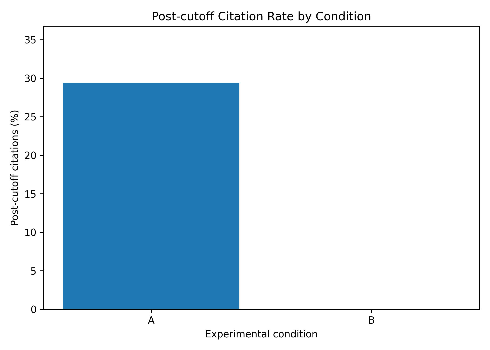
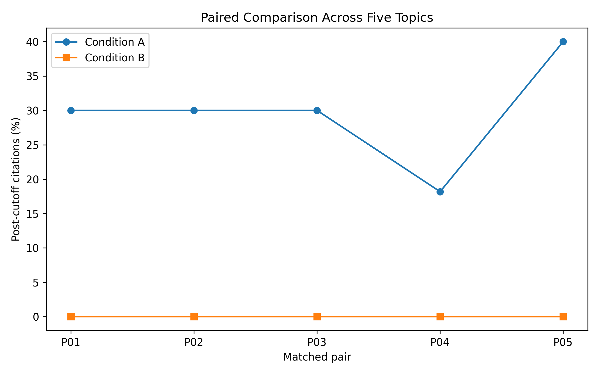
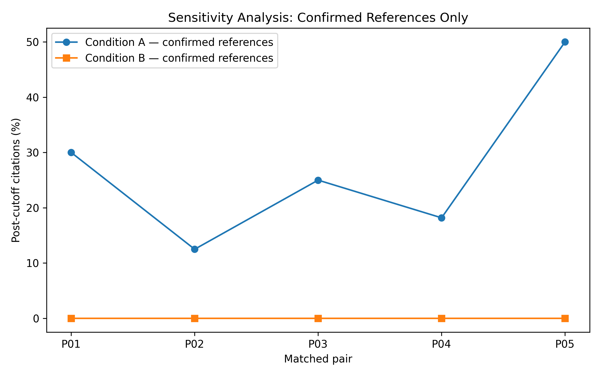

# 4. Results and Findings

## 4.1 Overview of the Dataset

The experiment generated ten literature reviews across five matched
prompt pairs. Citation extraction initially identified 100 candidate
bibliographic entries. One entry was classified as commentary rather
than a complete reference, leaving 99 citation instances for analysis.

The references were classified according to the publication-date
boundary of 31 December 2024, inclusive.

## 4.2 Overall Temporal Compliance

Condition A produced 15 post-cutoff citations among 51 citation
instances, corresponding to a post-cutoff rate of 29.41%.

Condition B produced no post-cutoff citations among 48 citation
instances. All 48 were classified as within the publication-date
boundary.

| Measure | Condition A | Condition B |
|---|---:|---:|
| Citation instances | 51 | 48 |
| Within cutoff | 36 | 48 |
| Post cutoff | 15 | 0 |
| Unknown year | 0 | 0 |
| Post-cutoff rate | 29.41% | 0.00% |

The observed difference in post-cutoff rates was 29.41 percentage
points in favour of Condition B.

## 4.3 Bibliographic Verification

The manual bibliographic audit classified the 100 extracted
candidate entries as follows:

| Decision | Number |
|---|---:|
| MATCH | 93 |
| PARTIAL_MATCH | 5 |
| DOI_MISMATCH | 1 |
| NOT_APPLICABLE | 1 |
| Total | 100 |

Among the 99 actual reference instances, 93 were classified as MATCH.
The remaining six consisted of five partial matches and one DOI
mismatch.

Condition A had 45 MATCH entries among 51 citation instances,
giving a bibliographic match rate of 88.24%.

Condition B had 48 MATCH entries among 48 citation instances,
giving a bibliographic match rate of 100%.

These results describe the manual audit decisions and should not be
interpreted as proof that every bibliographic detail is error-free.

## 4.4 Matched-Pair Comparison

The five matched pairs were compared using their respective
post-cutoff citation rates.

| Pair | Condition A | Condition B | Reduction |
|---|---:|---:|---:|
| P01 | 30.00% | 0.00% | 30.00 pp |
| P02 | 30.00% | 0.00% | 30.00 pp |
| P03 | 30.00% | 0.00% | 30.00 pp |
| P04 | 18.18% | 0.00% | 18.18 pp |
| P05 | 40.00% | 0.00% | 40.00 pp |
| Mean | 29.64% | 0.00% | 29.64 pp |

Every matched pair showed a lower post-cutoff citation rate under
Condition B. The mean paired reduction was 29.64 percentage points.

## 4.5 Sensitivity Analysis

A sensitivity analysis was conducted using only references classified
as MATCH in the manual bibliographic audit.

This restricted analysis retained 45 confirmed references in
Condition A and 48 in Condition B.

| Measure | Condition A | Condition B |
|---|---:|---:|
| Confirmed references | 45 | 48 |
| Within cutoff | 33 | 48 |
| Post cutoff | 12 | 0 |
| Post-cutoff rate | 26.67% | 0.00% |

The mean paired reduction in post-cutoff rates was 27.14 percentage
points. All five matched pairs continued to show a lower rate under
Condition B.

The sensitivity analysis therefore supports the consistency of the
descriptive pattern when unresolved bibliographic cases are excluded.

## 4.6 Statistical Interpretation

All five matched pairs showed a reduction in post-cutoff citation
rates under Condition B.

A two-sided exact sign test based on the five pairwise directions
gives p = 0.0625. This does not meet the conventional 0.05
significance threshold.

The sample contains only five matched pairs. Accordingly, the
results are interpreted primarily as descriptive evidence rather
than conclusive statistical proof.

## 4.7 Summary of Findings

The principal findings are:

1. Condition A produced a post-cutoff citation rate of 29.41%.
2. Condition B produced a post-cutoff citation rate of 0%.
3. All five matched pairs favoured Condition B.
4. The mean paired reduction was 29.64 percentage points.
5. The confirmed-reference sensitivity analysis retained a
   reduction of 27.14 percentage points.
6. Condition B had a higher bibliographic match rate in this sample.

Overall, the results indicate that adding an explicit publication-date
boundary instruction was associated with improved observable temporal
compliance in the generated literature reviews.
